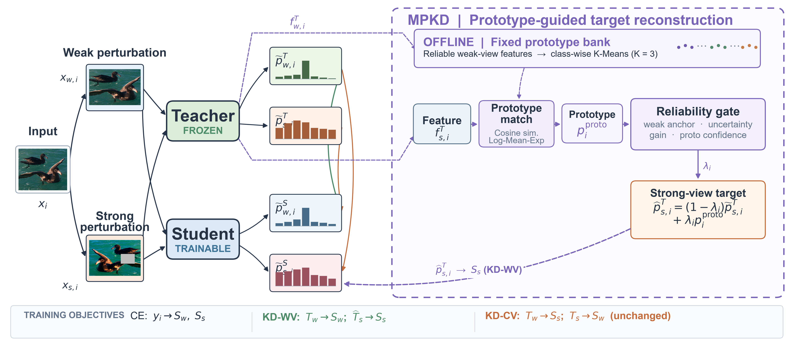
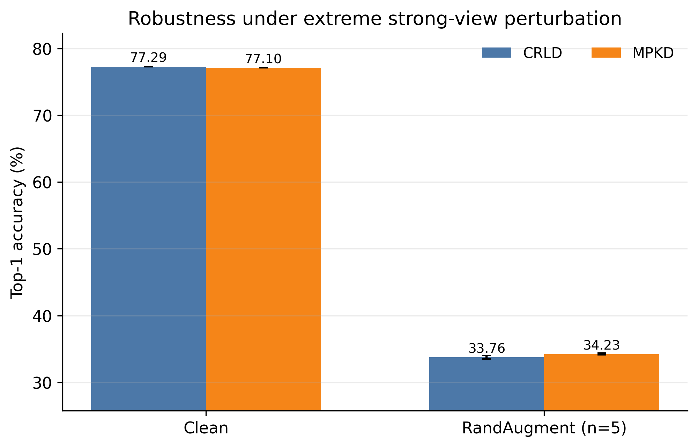
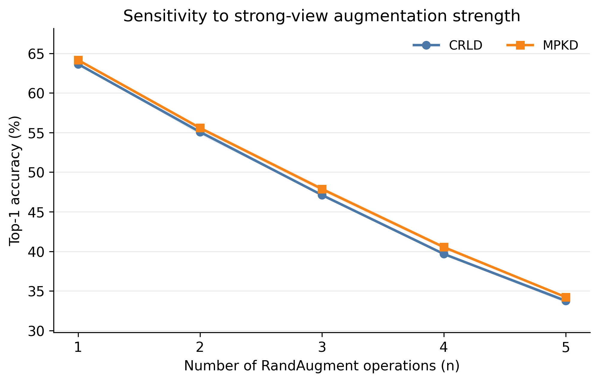
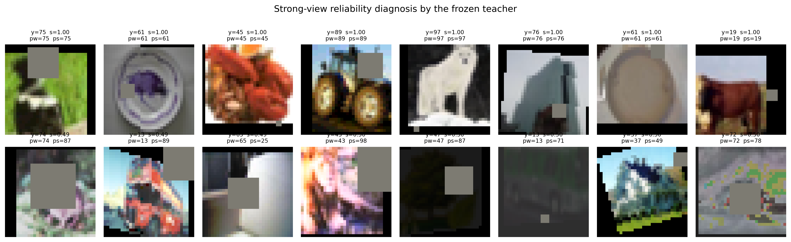

# MPKD：面向强视图教师偏差的多中心原型知识蒸馏

> Method + Experiments 汇报稿。本文方法在代码和配置中仍使用 `CRLD-Proto` 标识。本文汇报的是最终采用的**无 GLVQ 版本**：类别子原型仅由高可靠弱视图教师特征经过类内 K-Means 构建，不执行 GLVQ 判别式更新。

## 3. 我们的方法

### 3.1 方法概述

**图 1  MPKD 方法整体框架**

Hinton 等人提出的经典知识蒸馏通过联合优化真实标签监督与教师软目标监督，将教师模型的类别关系知识迁移给学生模型。其基本目标可写为

$$
\mathcal{L}_{\mathrm{total}}
=
\lambda_{\mathrm{CE}}\mathcal{L}_{\mathrm{CE}}
+
\lambda_{\mathrm{KD}}\mathcal{L}_{\mathrm{KD}}.
\tag{1}
$$

其中，\(\mathcal{L}_{\mathrm{total}}\) 表示总训练损失，\(\mathcal{L}_{\mathrm{CE}}\) 表示学生模型相对于真实标签的监督损失，\(\mathcal{L}_{\mathrm{KD}}\) 表示学生分布与教师软目标之间的蒸馏损失，\(\lambda_{\mathrm{CE}}\) 和 \(\lambda_{\mathrm{KD}}\) 表示平衡两类损失的权重。为扩大模型对输入扰动的泛化边界，CRLD 为同一样本构造弱增强视图 \(x_{w,i}\) 与强增强视图 \(x_{s,i}\)，其中 \(w\) 和 \(s\) 分别表示 weak 和 strong 视图，\(i\) 表示样本索引，并要求学生同时拟合两个视图上的真实标签。因此，双视图监督损失可概括为

$$
\mathcal{L}_{\mathrm{CE}}
=
\operatorname{CE}(p_{w,i}^{S},y_i)
+
\operatorname{CE}(p_{s,i}^{S},y_i).
\tag{2}
$$

其中，\(\operatorname{CE}(\cdot,\cdot)\) 表示交叉熵损失函数，\(y_i\) 表示第 \(i\) 个样本的真实类别标签，\(p_{w,i}^{S}\) 和 \(p_{s,i}^{S}\) 分别表示学生模型在弱增强视图和强增强视图下输出的类别概率分布；上标 \(S\) 表示学生模型，下标 \(w\) 和 \(s\) 分别表示弱视图和强视图。对于每个视图，交叉熵均以真实标签为监督目标，约束学生模型提高真实类别的预测概率；因此，式（2）同时对两个增强视图施加分类监督。

然而，双视图蒸馏隐含了教师在不同增强环境下均能提供可靠监督的假设。我们在 CIFAR-100 上的教师可靠性分析显示，教师在弱增强视图上仍保持较高预测可靠性，而在强增强视图下的预测准确率下降至 57.26%。这一显著差异表明，强随机扰动虽然能够扩展学生的表示边界，却也可能破坏教师原有的类别判别结构；若继续对教师强视图分布进行无差别对齐，错误监督将通过一致性约束传递给学生。

基于上述观察，我们认为稳健的双视图蒸馏不应直接舍弃全部强视图知识，也不应无条件信任受扰教师输出，而应借助稳定的全局类别结构判断何时以及以多大程度修正强视图目标。为此，本文提出面向强视图教师偏差的多中心原型知识蒸馏方法 MPKD（Multi-center Prototype Knowledge Distillation）。该方法以教师弱视图中的高可靠特征为原型来源，使用类内 K-Means 描述每个类别的多模态结构，并通过样本级可靠性门控将原型证据连续注入教师强视图软目标。正式版本不执行 GLVQ 判别式原型更新。

具体而言，冻结教师模型和待优化学生模型分别接收弱增强与强增强输入。模型 \(m\in\{T,S\}\) 在视图 \(v\in\{w,s\}\) 上输出 logits \(z_{v,i}^{m}\)。其原始概率以及温度软化概率分别为

$$
p_{v,i}^{m}=\operatorname{Softmax}(z_{v,i}^{m}),
\qquad
\widetilde{p}_{v,i}^{m}
=
\operatorname{Softmax}\left(\frac{z_{v,i}^{m}}{T}\right).
$$

其中，\(m\in\{T,S\}\) 表示教师模型或学生模型，\(v\in\{w,s\}\) 表示弱增强视图或强增强视图，\(z_{v,i}^{m}\) 表示模型 \(m\) 对第 \(i\) 个样本在视图 \(v\) 下输出的未归一化 logits 向量，\(p_{v,i}^{m}\) 表示经普通 Softmax 得到的预测概率分布，\(\widetilde{p}_{v,i}^{m}\) 表示经蒸馏温度 \(T\) 软化后的概率分布。\(T>0\) 为蒸馏温度，\(\operatorname{Softmax}(\cdot)\) 表示沿类别维度将 logits 映射为概率分布；\(i\) 为样本索引。

MPKD 的核心是可靠性感知多中心原型修正模块。该模块首先从教师弱视图中筛选预测正确且置信度较高的特征，通过 K-Means 获得固定类别子原型；然后将教师强视图特征与全部子原型的相似关系映射为原型类别分布；最后综合教师强视图不确定度、原型与弱视图锚点的一致性、锚定类别正向增益以及原型分布置信度，得到修正后的教师强视图分布 \(\widehat{p}_{s,i}^{T}\)。概念上，同视图蒸馏由弱视图和强视图两个互补项组成：

$$
\mathcal{L}_{\mathrm{KD}}
=
\mathcal{L}_{\mathrm{KD}}^{W}(p_{w,i}^{S},p_{w,i}^{T})
+
\mathcal{L}_{\mathrm{KD}}^{S}(p_{s,i}^{S},\widehat{p}_{s,i}^{T}).
\tag{3}
$$

其中，\(\mathcal{L}_{\mathrm{KD}}\) 表示同视图蒸馏损失，\(\mathcal{L}_{\mathrm{KD}}^{W}\) 和 \(\mathcal{L}_{\mathrm{KD}}^{S}\) 分别表示弱视图与强视图蒸馏项；\(p_{w,i}^{S}\) 和 \(p_{w,i}^{T}\) 分别表示学生与教师在弱视图下的预测分布，\(p_{s,i}^{S}\) 表示学生在强视图下的预测分布，\(\widehat{p}_{s,i}^{T}\) 表示经原型修正的教师强视图类别概率分布。上标 \(S\) 和 \(T\) 分别表示学生与教师，下标 \(w\) 和 \(s\) 分别表示弱视图与强视图。MPKD 仅修正强视图同视图蒸馏目标，其余 CRLD 损失保持不变，具体优化形式见式（12）至式（16）。

### 3.2 可靠性感知多中心原型修正

为利用教师弱视图中的稳定类别结构修正强视图预测偏差，我们设计了一个不依赖辅助网络的两阶段模块。离线阶段从冻结教师中构建 K-Means 多中心类别原型；在线阶段查询教师强视图特征，并在可靠性条件约束下完成概率级目标重构。

#### 3.2.1 高可靠弱视图原型挖掘

教师模型在原型构建和学生训练期间均保持冻结并处于推理模式。首先提取教师弱视图特征 \(f_{w,i}^{T}\)，并进行 L2 归一化。教师弱视图的熵置信度定义为

$$
r_{w,i}^{T}
=
1-\frac{H(p_{w,i}^{T})}{\log C},
\qquad
H(p)=-\sum_{c=1}^{C}p_c\log p_c.
\tag{4}
$$

其中，\(r_{w,i}^{T}\) 表示教师对第 \(i\) 个样本弱视图预测的归一化熵置信度，\(H(p_{w,i}^{T})\) 表示教师弱视图概率分布的熵，\(p_{w,i,c}^{T}\) 表示该分布在类别 \(c\) 上的概率，\(C\) 表示类别总数，\(c\) 为类别索引。式中的 \(p_c\) 是概率分布 \(p\) 在类别 \(c\) 上的分量，\(\log C\) 是 \(C\) 类均匀分布的最大熵。熵越小，\(r_{w,i}^{T}\) 越大，表示教师预测越确定。

只保留教师预测正确且熵置信度达到阈值 \(\tau_w^{\mathrm{proto}}\) 的样本：

$$
m_i^{\mathrm{proto}}
=
\mathbb{I}\left(\arg\max_c p_{w,i,c}^{T}=y_i\right)
\mathbb{I}\left(r_{w,i}^{T}\geq\tau_w^{\mathrm{proto}}\right).
\tag{5}
$$

其中，\(m_i^{\mathrm{proto}}\in\{0,1\}\) 表示第 \(i\) 个样本是否被选入原型构建集合，\(\mathbb{I}(\cdot)\) 表示指示函数，条件成立时取 1，否则取 0；\(\arg\max_c p_{w,i,c}^{T}\) 表示教师弱视图的预测类别，\(y_i\) 表示真实标签，\(\tau_w^{\mathrm{proto}}\) 表示原型挖掘的置信度阈值。上标 \(\mathrm{proto}\) 仅用于标识该变量属于原型构建或原型推断分支，并不表示幂运算。两个指示函数相乘意味着样本必须同时满足“教师预测正确”和“熵置信度不低于阈值”两个条件。

对每个类别 \(c\) 的可靠特征独立执行球面 K-Means。本文固定每类子原型数 \(K=3\)，并执行 10 次聚类更新。样本分配和中心更新写为

$$
a_i
=
\arg\max_k\cos\left(f_{w,i}^{T},p_{c,k}\right),
\qquad y_i=c,
\tag{6}
$$

其中，\(a_i\) 表示样本 \(i\) 被分配到的子原型索引，\(f_{w,i}^{T}\) 表示教师从弱增强视图提取的特征，\(p_{c,k}\) 表示类别 \(c\) 的第 \(k\) 个子原型，\(k\in\{1,\ldots,K\}\) 为子原型索引，\(\cos(\cdot,\cdot)\) 表示余弦相似度。条件 \(y_i=c\) 表示该分配操作仅在真实类别为 \(c\) 的可靠样本内进行。

$$
p_{c,k}
=
\frac{
\sum_i\mathbb{I}(y_i=c)\mathbb{I}(a_i=k)m_i^{\mathrm{proto}}f_{w,i}^{T}
}{
\lVert
\sum_i\mathbb{I}(y_i=c)\mathbb{I}(a_i=k)m_i^{\mathrm{proto}}f_{w,i}^{T}
\rVert_2
}.
\tag{7}
$$

其中，\(p_{c,k}\) 表示类别 \(c\) 的第 \(k\) 个更新后子原型，\(m_i^{\mathrm{proto}}\) 用于筛选通过可靠性条件的样本，\(\mathbb{I}(y_i=c)\) 和 \(\mathbb{I}(a_i=k)\) 分别表示样本真实类别为 \(c\) 以及被分配到第 \(k\) 个子簇的条件。分子是对应簇内可靠特征的向量和，\(\lVert\cdot\rVert_2\) 表示 L2 范数，分母用于将该向量归一化到单位球面；\(\sum_i\) 表示对训练集样本求和。\(C\) 和 \(K\) 分别表示类别总数和每类子原型数量。

式（7）表示对簇内特征均值重新归一化。最终得到 \(C\times K\) 个固定子原型。正式版本不执行 GLVQ，不引入原型学习率、GLVQ 迭代轮数或相对距离损失；原型也不参与学生训练阶段的反向传播。

#### 3.2.2 强视图原型分布生成

对教师强视图特征 \(f_{s,i}^{T}\) 进行 L2 归一化，并计算其与各类别子原型的余弦相似度：

$$
s_{i,c,k}
=
\cos\left(f_{s,i}^{T},p_{c,k}\right).
\tag{8}
$$

其中，\(s_{i,c,k}\) 表示教师强视图特征与类别 \(c\) 的第 \(k\) 个子原型之间的余弦相似度，\(f_{s,i}^{T}\) 表示教师从强增强视图提取的第 \(i\) 个样本特征，\(p_{c,k}\) 表示式（7）得到的固定子原型；\(i\)、\(c\) 和 \(k\) 分别表示样本、类别和子原型索引。由于特征和原型均经过 L2 归一化，\(s_{i,c,k}\) 越大表示两者在特征方向上越接近。

同一类别内部的多个子原型通过 Log-Mean-Exp 进行平滑汇总：

$$
g_{i,c}
=
\log\left[
\frac{1}{K}
\sum_{k=1}^{K}
\exp\left(\frac{s_{i,c,k}}{\tau_p}\right)
\right].
\tag{9}
$$

其中，\(g_{i,c}\) 表示样本 \(i\) 的教师强视图特征 \(f_{s,i}^{T}\) 对类别 \(c\) 的类别级原型匹配得分。该量不是概率，而是将 \(f_{s,i}^{T}\) 与类别 \(c\) 的 \(K\) 个子原型之间的余弦相似度，经原型温度 \(\tau_p\) 缩放后利用 Log-Mean-Exp 平滑汇总得到的未归一化类别证据。\(s_{i,c,k}\) 表示样本 \(i\) 与类别 \(c\) 第 \(k\) 个子原型的余弦相似度，\(K\) 为每个类别的子原型数量，\(\tau_p>0\) 为原型温度，\(\exp(\cdot)\) 和 \(\log(\cdot)\) 分别表示指数函数和自然对数。\(g_{i,c}\) 越大，表示原型空间越支持将该样本判定为类别 \(c\)；当 \(\tau_p\) 较小时，匹配度最高的子原型对该得分的影响更加突出。

将样本 \(i\) 在全部 \(C\) 个类别上的匹配得分沿类别维度归一化，得到原型类别分布 \(p_i^{\mathrm{proto}}=[p_{i,1}^{\mathrm{proto}},\ldots,p_{i,C}^{\mathrm{proto}}]\)。其在类别 \(c\) 上的概率显式定义为

$$
p_{i,c}^{\mathrm{proto}}
=
\frac{
\exp(g_{i,c})
}{
\sum_{j=1}^{C}\exp(g_{i,j})
}
=
\frac{
\sum_{k=1}^{K}\exp\left(s_{i,c,k}/\tau_p\right)
}{
\sum_{j=1}^{C}\sum_{k=1}^{K}
\exp\left(s_{i,j,k}/\tau_p\right)
},
\qquad c=1,\ldots,C.
\tag{10}
$$

其中，\(p_{i,c}^{\mathrm{proto}}\) 表示原型分支赋予样本 \(i\) 属于类别 \(c\) 的概率，\(j\) 是分母中遍历全部类别的索引。分子汇总类别 \(c\) 的 \(K\) 个子原型对该样本提供的指数化匹配证据，分母汇总全部 \(C\) 个类别、共 \(C\times K\) 个子原型的匹配证据，从而保证 \(p_{i,c}^{\mathrm{proto}}\geq0\) 且 \(\sum_{c=1}^{C}p_{i,c}^{\mathrm{proto}}=1\)。根据式（9），\(\exp(g_{i,c})=\frac{1}{K}\sum_{k=1}^{K}\exp(s_{i,c,k}/\tau_p)\)；由于每个类别使用相同数量的子原型，归一化时公共因子 \(1/K\) 在分子和分母中相互抵消，因此式（10）的两个表达式完全等价。

这里使用的是余弦相似度而不是余弦距离，因此数值越大表示强视图特征越接近相应子原型。Log-Mean-Exp 在最大相似度与类别内平均证据之间形成平滑过渡，避免只依赖单个中心或对所有子原型进行等权平均。

#### 3.2.3 可靠性门控与连续概率重构

教师弱视图通常比强视图稳定，因此将弱视图预测类别作为原型修正的类别锚点。在线训练时，可靠性门控综合考虑教师强视图的不确定程度、原型分布与类别锚点的一致性、原型对锚定类别的支持情况以及原型分布本身的可信程度，得到样本级融合权重 \(\lambda_i\)。当强视图更不确定且原型证据与类别锚点一致、能够提供正向支持时，门控倾向于增大；当原型证据不一致、未提供有效支持或自身不确定时，门控减小或置为零。由此，原型只作为有条件的补充证据参与强视图目标修正，不会对所有样本进行无差别替换。

利用该权重对教师强视图分布和原型分布进行凸组合，得到修正后的教师强视图目标：

$$
\widehat{p}_{s,i,c}^{T}
=
(1-\lambda_i)\widetilde{p}_{s,i,c}^{T}
+
\lambda_i p_{i,c}^{\mathrm{proto}},
\qquad c=1,\ldots,C.
\tag{11}
$$

其中，\(\widetilde{p}_{s,i,c}^{T}\) 为教师强视图经温度 \(T\) 软化后的原始类别概率，\(p_{i,c}^{\mathrm{proto}}\) 为式（10）得到的原型类别概率，\(\lambda_i\in[0,1]\) 为样本级可靠性融合权重。\(\widehat{p}_{s,i}^{T}\) 是用于同视图蒸馏的修正目标，而不是新的教师 Logit 或硬标签；当 \(\lambda_i=0\) 时保留原始教师目标，\(\lambda_i>0\) 时按可靠程度引入原型证据。真实标签仅用于式（5）的离线原型样本筛选，不参与在线融合。

### 3.3 优化目标与训练流程

MPKD 采用冻结教师、端到端优化学生的训练范式。教师仅负责生成双视图预测和强视图特征，训练过程中只更新学生模型参数。对于包含 \(N\) 个样本的训练批次，双视图监督损失定义为

$$
\mathcal{L}_{\mathrm{CE}}
=
-\frac{1}{N}\sum_{i=1}^{N}
\left[
\log p_{w,i}^{S}(y_i)
+
\log p_{s,i}^{S}(y_i)
\right].
\tag{12}
$$

其中，\(\mathcal{L}_{\mathrm{CE}}\) 表示双视图交叉熵损失，\(y_i\) 为第 \(i\) 个样本的真实标签，\(p_{w,i}^{S}(y_i)\) 和 \(p_{s,i}^{S}(y_i)\) 分别表示学生模型在弱视图和强视图下赋予真实类别 \(y_i\) 的预测概率，\(N\) 为批次大小。

同视图蒸馏损失定义为

$$
\mathcal{L}_{\mathrm{KD}}^{\mathrm{WV}}
=
\frac{1}{N}\sum_{i=1}^{N}m_{w,i}
\left[
D_{\mathrm{KL}}\left(\widetilde{p}_{w,i}^{T}\Vert\widetilde{p}_{w,i}^{S}\right)
+
D_{\mathrm{KL}}\left(\widehat{p}_{s,i}^{T}\Vert\widetilde{p}_{s,i}^{S}\right)
\right].
\tag{13}
$$

其中，\(\mathcal{L}_{\mathrm{KD}}^{\mathrm{WV}}\) 表示同视图蒸馏损失；\(\widetilde{p}_{w,i}^{T}\) 和 \(\widetilde{p}_{w,i}^{S}\) 分别为教师与学生的弱视图温度软化分布；\(\widehat{p}_{s,i}^{T}\) 为式（11）得到的教师强视图修正分布，\(\widetilde{p}_{s,i}^{S}\) 为学生强视图温度软化分布。\(m_{w,i}=\mathbb{I}(\max_c p_{w,i,c}^{T}\geq\tau_w)\) 为 CRLD 的弱视图置信度掩码，其中 \(\mathbb{I}(\cdot)\) 表示指示函数，\(\tau_w\) 表示弱视图置信度阈值。

交叉视图蒸馏损失定义为

$$
\mathcal{L}_{\mathrm{KD}}^{\mathrm{CV}}
=
\frac{1}{N}\sum_{i=1}^{N}m_{s,i}
\left[
D_{\mathrm{KL}}\left(\widetilde{p}_{w,i}^{T}\Vert\widetilde{p}_{s,i}^{S}\right)
+
D_{\mathrm{KL}}\left(\widetilde{p}_{s,i}^{T}\Vert\widetilde{p}_{w,i}^{S}\right)
\right].
\tag{14}
$$

其中，\(\mathcal{L}_{\mathrm{KD}}^{\mathrm{CV}}\) 表示交叉视图蒸馏损失，\(\widetilde{p}_{s,i}^{T}\) 为未经原型修正的教师强视图温度软化分布。第一项由教师弱视图监督学生强视图，第二项由教师强视图监督学生弱视图。\(m_{s,i}=\mathbb{I}(\max_c p_{s,i,c}^{T}\geq\tau_s)\) 为 CRLD 的强视图置信度掩码，\(\tau_s\) 表示强视图置信度阈值。式（14）的两个方向均保持原始 CRLD 形式。

上述蒸馏项采用温度缩放的 KL 散度：

$$
D_{\mathrm{KL}}(P\Vert Q)
=
T^2\sum_{c=1}^{C}
P(c)\log\frac{P(c)}{Q(c)}.
\tag{15}
$$

其中，\(P\) 表示教师提供的目标概率分布，\(Q\) 表示学生需要拟合的预测概率分布，\(P(c)\) 和 \(Q(c)\) 分别为两者在类别 \(c\) 上的概率，\(C\) 为类别总数，\(T\) 为蒸馏温度；\(T^2\) 用于补偿温度软化造成的梯度幅值变化。

总训练目标为

$$
\mathcal{L}_{\mathrm{total}}
=
\alpha\mathcal{L}_{\mathrm{CE}}
+
\beta\mathcal{L}_{\mathrm{KD}}^{\mathrm{WV}}
+
\gamma\mathcal{L}_{\mathrm{KD}}^{\mathrm{CV}}.
\tag{16}
$$

其中，\(\mathcal{L}_{\mathrm{total}}\) 表示总训练损失，\(\alpha\)、\(\beta\) 和 \(\gamma\) 分别为监督损失、同视图蒸馏损失和交叉视图蒸馏损失的权重。本文固定 \(\alpha=1\)，\(\beta\) 与 \(\gamma\) 沿用各教师—学生架构对应的 CRLD 设置。

因此，MPKD 保留完整 CRLD 优化结构，唯一变化位于式（13）的强视图同视图蒸馏项；式（14）的交叉视图蒸馏不接受原型修正。

### 3.4 训练算法

给定训练集、冻结教师模型、待训练学生模型以及弱增强和强增强变换，MPKD 的训练过程包括离线原型构建和在线学生优化两个阶段。

**算法 1  MPKD 的整体训练流程**

**输入：**训练集 \(\mathcal{D}\)、冻结教师模型 \(T\)、学生模型 \(S\)、弱增强变换、强增强变换及原型参数 \(K\) 和 \(\tau_p\)。

**输出：**优化后的学生模型 \(S\)。

| 算法步骤 | 公式编号 |
| --- | ---: |
| 1. 将教师模型设为推理模式并冻结其参数和 BatchNorm 统计量。 | |
| 2. 对训练样本生成弱视图，提取归一化教师特征并计算弱视图熵置信度。 | （4） |
| 3. 保留教师预测正确且置信度不低于 \(\tau_w^{\mathrm{proto}}\) 的样本。 | （5） |
| 4. 对各类别的可靠特征执行类内 K-Means，交替完成样本分配和中心更新，得到 \(K\) 个子原型。 | （6）、（7） |
| 5. 固定全部类别子原型，进入学生在线优化阶段。 | |
| 6. 对每个批次生成弱视图和强视图，并由教师提取双视图预测及强视图特征，由学生输出双视图预测。 | |
| 7. 计算强视图特征与各子原型的相似度，并得到原型类别分布。 | （8）—（10） |
| 8. 以教师弱视图预测为类别锚点，依据可靠性信息得到融合权重，并生成修正后的教师强视图目标。 | （11） |
| 9. 计算双视图监督、同视图蒸馏、交叉视图蒸馏及总损失，仅更新学生模型参数。 | （12）—（16） |
| 10. 重复步骤 6 至步骤 9，直至完成训练，输出优化后的学生模型。 | |

上述流程不引入可学习原型参数或额外学生特征损失。原型只在训练阶段参与教师目标重构；测试时直接使用学生模型前向传播，因此不会增加推理分支、参数量或计算成本。

## 4. 实验

本章围绕三个问题对 MPKD 进行实验分析：第一，多中心原型修正能否在不同教师—学生架构之间保持有效；第二，多中心原型与整体可靠性门控分别产生何种影响；第三，方法在跨数据集、强分布偏移和不同增强强度下是否具有稳定性。当前已完成的定量结果均来自 CIFAR-100；尚未完成的实验统一标记为“未跑”，不使用参考论文中的结果代替本地实验。

### 4.1 数据集

为评估 MPKD 在图像分类知识蒸馏任务中的性能，本文沿用 CRLD 的基本评价场景，并规划在 CIFAR-100、Tiny-ImageNet-200 和 ImageNet-1K 上进行验证。各数据集及当前实验状态如下。

- **CIFAR-100：**该数据集包含 100 个类别，共有 50,000 张训练图像和 10,000 张测试图像，图像分辨率为 32×32。本文关于同构架构、异构架构及结构消融的所有已报告结果均在该数据集上获得。
- **Tiny-ImageNet-200：**该数据集包含 200 个类别、100,000 张训练图像和 10,000 张验证图像，图像分辨率为 64×64。当前已完成数据目录整理和 ResNet32x4 教师权重准备，但 MPKD 学生蒸馏实验为**未跑**。
- **ImageNet-1K：**该数据集包含 1,000 个类别，训练集约含 128 万张图像，验证集含 50,000 张图像。当前已完成标准目录整理，并准备了 ResNet34 和 ResNet50 的公开教师权重，但 MPKD 学生蒸馏实验为**未跑**。

因此，本章现阶段的经验结论仅适用于 CIFAR-100。Tiny-ImageNet-200 和 ImageNet-1K 只作为已准备但尚未完成的扩展评价任务，不参与当前性能统计。

### 4.2 实验设置

遵循 CRLD 的实验协议，本文选用 ResNet、Wide ResNet（WRN）、VGG、MobileNetV2 和 ShuffleNetV2 作为教师与学生骨干网络，以评价 MPKD 在同构和异构蒸馏场景中的表现。

在 CIFAR-100 上，所有学生模型训练 240 个 epoch，批量大小为 64，并采用 SGD 优化器。动量设为 0.9，权重衰减设为 \(5\times10^{-4}\)。常规卷积学生的初始学习率为 0.05，MobileNetV2 与 ShuffleNetV2 学生的初始学习率为 0.01；学习率在第 150、180 和 210 个 epoch 衰减为原来的 0.1。弱视图采用随机裁剪和水平翻转，强视图在此基础上加入 RandAugment 与 Cutout。

MPKD 沿用各教师—学生组合对应的 CRLD 蒸馏设置，监督损失权重统一设为 \(\alpha=1\)。每个类别使用 \(K=3\) 个子原型，并通过 10 次类内 K-Means 更新完成构建。正式方法不使用 GLVQ，教师与离线原型在学生训练期间保持冻结。所有已报告结果均采用随机种子 42；Tiny-ImageNet-200 与 ImageNet-1K 的 MPKD 训练尚未运行。

### 4.3 基线方法与评价指标

为全面评价 MPKD 的性能，本文参考 CRLD 及相关知识蒸馏工作的实验设置，选取 26 种具有代表性的基线方法进行比较。根据各方法的主要知识传递对象和技术路线，基线方法划分为以下六类：

- **特征对齐与注意力迁移：**FitNets（Romero 等，2014），通过中间层提示进行特征迁移；AT（Zagoruyko 和 Komodakis，2016a），利用空间注意力图约束学生表示；OFD（Heo 等，2019），对教师特征进行重新设计以提高特征蒸馏效果；FCFD（Liu 等，2023），从函数一致性的角度进行特征蒸馏。
- **关系建模与对比表示学习：**RKD（Park 等，2019），保持样本之间的距离和角度关系；CRD（Tian 等，2019），通过对比学习最大化教师与学生表示之间的互信息。
- **表示学习与多维特征融合：**SRRL（Yang 等，2021b），学习教师表示到学生分类空间的回归映射；ICKD（Liu 等，2021），建模跨通道相关性；PEFD（Chen 等，2022b），利用投影器集成传递特征知识；CAT-KD（Guo 等，2023），引入类别注意力机制；TaT（Lin 等，2022），通过目标感知机制增强知识迁移；ReviewKD（Chen 等，2021），融合不同层级的特征表示；SimKD（Chen 等，2022a），复用教师分类器以改善学生的表示学习。
- **全分布对齐与类别解耦：**经典 KD（Hinton 等，2015），通过 KL 散度对齐教师和学生的软概率分布；DKD（Zhao 等，2022），将目标类知识和非目标类知识解耦；NKD（Yang 等，2023），对非目标类别知识进行归一化建模；JCS-MKD（Ding 等，2025），联合建模目标类和非目标类 Logit 关系。
- **动态调节与分布重构：**CTKD（Li 等，2023a），采用课程式温度调节蒸馏难度；NormKD（Chi 等，2023），对 Logit 进行归一化处理；LSKD（Sun 等，2024），通过 Logit 标准化改善分布对齐；TopKD（Wang 和 Zhou，2025），结合拓扑筛选与自适应缩放传递知识；TTM（Zheng 和 Yang，2024），通过变换后的教师目标进行匹配；BDD（Qi 等，2026），采用平衡的正向与反向散度进行分布对齐。
- **鲁棒性、一致性与多层级蒸馏：**TAKD（Mirzadeh 等，2020），引入教师助理缓解师生能力差距；MLLD（Jin 等，2023），进行多层级 Logit 密集对齐；CRLD（Zhang 等，2024），通过弱增强视图与强增强视图之间的交叉一致性约束提升模型鲁棒性。

在上述方法中，CRLD 作为本文的主要竞争基线。CRLD 与 MPKD 均采用弱增强视图和强增强视图进行训练，并通过同视图蒸馏与交叉视图蒸馏建立跨视图一致性。MPKD 在 CRLD 的基础上引入多中心原型机制，用于修正强视图教师的蒸馏目标。因此，CRLD 能够作为与 MPKD 结构最接近的直接比较对象，用于评价所提出方法的有效性。其余基线方法用于提供不同知识蒸馏范式下的性能参考，具体结果以相应论文、公开 benchmark 或本项目已经完成的实验记录为准。

遵循 CRLD 及相关知识蒸馏工作的评价方式，本文采用 Top-1 Accuracy 和 Top-5 Accuracy 两项标准指标评价模型性能。Top-1 准确率表示模型预测得分最高的类别与真实类别一致的测试样本比例；Top-5 准确率表示真实类别位于模型预测得分最高的五个候选类别中的测试样本比例。Top-1 准确率主要反映模型的首选类别判别能力，Top-5 准确率则用于补充衡量模型对候选类别的整体排序能力。

本文主结果表主要报告 Top-1 准确率。对于每个教师—学生架构，MPKD 的结果取训练过程中评估集 Top-1 准确率的最高值，即训练日志中的 best_acc；训练程序同时记录 Top-5 准确率、最终测试损失和最佳 epoch 作为辅助信息。表中的 AVG 表示同一组教师—学生架构结果的算术平均值。CRLD 的对照值来自原论文或公开 benchmark，MPKD 的数值来自本项目实际完成的本地训练；尚未完成的实验统一标记为“未跑”，不使用其他论文中的数值替代本地结果。
### 4.4 实验结果

#### 4.4.1 主要结果

遵循 CRLD [37] 及 TopKD [72] 的实验设置，本文在 CIFAR-100 上评估 MPKD 的性能。表 1 和表 2 分别报告异构和同构教师—学生组合的 Top-1 准确率，其中异构蒸馏表示教师与学生来自不同网络族，同构蒸馏表示二者属于同一网络族。表中每一列对应一组教师—学生组合，表头依次列出教师模型和学生模型，括号内数字表示未使用知识蒸馏时相应模型的 Top-1 准确率。各方法的对照结果来自原论文或公开 benchmark，MPKD 结果来自相同实验协议下的本地训练；AVG 表示方法在所有组合上的平均准确率，加粗结果表示对应组合中的最佳结果。

**表 1  CIFAR-100 上异构教师—学生组合的 Top-1 准确率**

| 教师 → 学生 | CRLD | MPKD | 差值 |
| --- | ---: | ---: | ---: |
| ResNet32x4 → ShuffleNetV2 | 78.27% | **79.38%** | +1.11 |
| ResNet32x4 → WRN16-2 | 76.92% | **77.36%** | +0.44 |
| ResNet50 → MobileNetV2 | 71.36% | **71.39%** | +0.03 |
| VGG13 → MobileNetV2 | 70.39% | **71.67%** | +1.28 |
| WRN40-2 → MobileNetV2 | 70.37% | **71.24%** | +0.87 |
| WRN40-2 → ResNet8x4 | 77.28% | **77.54%** | +0.26 |
| AVG | 74.10% | **74.76%** | +0.67 |

实验结果表明，MPKD 在不同教师—学生架构组合下均具有较强的竞争力。如表 1 所示，在异构蒸馏设置中，MPKD 在六组组合中的四组取得最高 Top-1 准确率，在其余两组中取得第二高结果。与 CRLD 相比，MPKD 的平均准确率由 74.10% 提升至 74.76%。这说明基于多中心原型的强视图教师目标修正能够适应不同网络族之间的表示差异，在不进行中间特征对齐的情况下改善异构知识传递效果。

**表 2  CIFAR-100 上同构教师—学生组合的 Top-1 准确率**

| 教师 → 学生 | CRLD | MPKD | 差值 |
| --- | ---: | ---: | ---: |
| ResNet56 → ResNet20 | 72.10% | **72.63%** | +0.53 |
| ResNet110 → ResNet32 | 74.42% | **75.21%** | +0.79 |
| ResNet32x4 → ResNet8x4 | **77.60%** | 77.44% | -0.16 |
| WRN40-2 → WRN16-2 | 76.45% | **77.36%** | +0.91 |
| WRN40-2 → WRN40-1 | 75.58% | **76.05%** | +0.47 |
| VGG13 → VGG8 | 75.27% | **75.59%** | +0.32 |
| AVG | 75.24% | **75.71%** | +0.48 |

如表 2 所示，在同构蒸馏设置中，MPKD 在六组组合中的五组取得最高 Top-1 准确率，在剩余一组中取得第二高结果。MPKD 的平均准确率由 75.24% 提升至 75.71%，其中 WRN40-2→WRN16-2 和 ResNet110→ResNet32 的提升较为明显。该结果表明，弱视图可靠类别结构能够为同一网络族内的强视图目标修正提供有效先验；同时，ResNet32x4→ResNet8x4 上的结果也说明原型修正的收益仍会受到具体架构和训练配置的影响。

综合两类架构结果，MPKD 在大多数已测教师—学生组合上优于 CRLD，最高 Top-1 准确率达到 79.38%。这表明 MPKD 能够在同构和异构蒸馏场景中提供具有迁移性的强视图监督修正，但由于当前主结果主要基于单次运行，个别幅度较小的提升仍需通过多随机种子实验进一步验证。

Tiny-ImageNet-200 与 ImageNet-1K 的扩展实验状态列于表 3。由于这些学生蒸馏任务尚未执行，本章不报告 Top-1、Top-5 或任何估计结果。

**表 3  跨数据集 MPKD 实验状态**

| 数据集 | 教师 → 学生 | MPKD 结果 | 当前状态 |
| --- | --- | --- | --- |
| Tiny-ImageNet-200 | ResNet32x4 → ResNet8x4 | 未跑 | 数据与教师权重已准备 |
| ImageNet-1K | ResNet34 → ResNet18 | 未跑 | 数据与教师权重已准备 |
| ImageNet-1K | ResNet50 → MobileNetV1 | 未跑 | 数据与教师权重已准备 |

#### 4.4.2 消融与泛化实验

**（1）面向现有 Logit 蒸馏方法的泛化能力**

为考察 MPKD 是否能够推广到不同的类别级 Logit 蒸馏目标，本文参考模板的组织方式，计划在 CIFAR-100 的六组教师—学生架构上比较经典 KD、DKD 和 NKD，以及它们与 CRLD 或 MPKD 结合后的结果。每种基础蒸馏方法均保留自身的类别级损失定义；CRLD 负责建立弱视图与强视图之间的双视图训练框架，MPKD 仅对教师强视图的同视图蒸馏目标进行原型修正，不直接叠加两个完整总损失。

**表 4  现有 Logit 蒸馏方法上的泛化实验**

| 方法 | R56→R20 | R110→R32 | R32x4→R8x4 | W40-2→W16-2 | W40-2→W40-1 | VGG13→VGG8 | AVG |
| --- | ---: | ---: | ---: | ---: | ---: | ---: | ---: |
| KD | 未跑 | 未跑 | 未跑 | 未跑 | 未跑 | 未跑 | 未跑 |
| KD + CRLD | 72.10%* | 74.42%* | 77.60%* | 76.45%* | 75.58%* | 75.27%* | 75.24%* |
| KD + MPKD | 未跑 | 未跑 | 未跑 | 未跑 | 未跑 | 未跑 | 未跑 |
| DKD | 未跑 | 未跑 | 未跑 | 未跑 | 未跑 | 未跑 | 未跑 |
| DKD + CRLD | 未跑 | 未跑 | 未跑 | 未跑 | 未跑 | 未跑 | 未跑 |
| DKD + MPKD | 未跑 | 未跑 | 未跑 | 未跑 | 未跑 | 未跑 | 未跑 |
| NKD | 未跑 | 未跑 | 未跑 | 未跑 | 未跑 | 未跑 | 未跑 |
| NKD + CRLD | 未跑 | 未跑 | 未跑 | 未跑 | 未跑 | 未跑 | 未跑 |
| NKD + MPKD | 未跑 | 未跑 | 未跑 | 未跑 | 未跑 | 未跑 | 未跑 |

注：带 * 的一行对应表 1 和表 2 中已经报告的 CRLD 基线结果，仅作已有结果复用，不代表新增的兼容性运行；其余单元格均为严格兼容性实验，当前尚未运行。表 1 和表 2 中的 MPKD 主结果保留了完整 CRLD 双视图结构，因此不直接等同于严格定义下的“KD + MPKD”结果。

**（2）Ablation Study on View Construction and Target Reconstruction**

为分析双视图构建与强视图教师软目标重构的独立贡献，本文在 CIFAR-100
数据集上采用 ResNet110→ResNet32 教师—学生组合进行消融实验。我们逐步
保留弱视图和强视图分支，并在完整双视图结构上加入原型引导的强视图教师
软目标重构。实验结果如表 5 所示。

**Table 5. Ablation study on view construction and target reconstruction on CIFAR-100.**

| Method | Weak View | Strong View | Prototype-Based Strong-View Target Reconstruction | Top-1 (%) |
| :---: | :---: | :---: | :---: | ---: |
| I | √ | — | — | 未跑 |
| II | — | √ | — | 未跑 |
| III (CRLD) | √ | √ | — | 74.42%* |
| IV | √ | √ | √, fixed fusion | 未跑 |
| V (MPKD) | √ | √ | √, reliability-gated fusion | 75.21%* |

其中，I 和 II 分别表示仅保留弱视图或强视图的单视图设置；III 为不进行
原型目标重构的完整 CRLD；IV 在双视图 CRLD 的基础上采用固定权重进行原型
目标重构；V 为本文的完整 MPKD。对于 IV 和 V，原型均由离线阶段筛选出的
高可靠弱视图教师特征构建。需要强调的是，原型修正并不改变学生的分类
监督，也不直接参与学生特征学习，而是仅替换教师强视图的同视图蒸馏目标。

由于 I、II 和 IV 尚未完成，表 5 当前不据此给出完整的性能排序。已获得的
III 与 V 结果表明，在相同的双视图框架下引入原型目标重构后，ResNet110→ResNet32
的 Top-1 准确率由 74.42% 提升至 75.21%。带 * 的结果复用表 2 中的对应结果，
正式消融实验应在相同随机种子、训练轮次和数据增强设置下重新获得全部行的
结果。

为进一步说明可靠性门控在原型目标重构中的作用，本文在
ResNet32x4→ResNet8x4 组合上进行整体模块对照。所有设置均采用随机种子 42、
训练 240 个 epoch，并固定每类 3 个子原型；除原型融合方式外，其余训练
设置保持一致。结果见表 6。

**Table 6. Analysis of reliability-gated target reconstruction on CIFAR-100.**

| Method | Prototype-Based Target Reconstruction | Reliability Gate | Best Acc (%) | Δ vs. CRLD |
| :---: | :---: | :---: | ---: | ---: |
| CRLD | — | — | 77.29 | 0.00 |
| MPKD w/o Gate | Fixed-weight fusion | — | **77.72** | +0.43 |
| MPKD (Ours) | Prototype fusion | Enabled | 77.44 | +0.15 |

表 6 表明，多中心原型的固定权重融合已经能够带来 0.43 个百分点的提升，
说明可靠弱视图特征包含可用于修正强视图教师目标的类别先验。在此基础上
加入整体可靠性门控后，模型仍比 CRLD 高 0.15 个百分点，但低于无门控的
固定融合结果。该现象说明，门控能够限制不可靠原型证据的无条件注入，但
当前参数下其筛选作用也会削弱部分有效原型信息。这里仅将门控作为一个
整体模块进行分析，不再拆分其内部因子。

#### 4.4.3 鲁棒性与敏感性分析

为检验 MPKD 对强视图分布偏移的适应能力，本节在 CIFAR-100 的
ResNet32x4→ResNet8x4 任务上，对本地保存的完整 CRLD 对照模型和 MPKD 模型进行
配对评估。两种模型使用相同的测试样本、相同的随机种子和相同的增强结果；每个
增强强度重复生成 3 组视图，并报告 Top-1 的均值和标准差。评估时原型不参与
学生模型的前向计算，MPKD 的结果完全由训练完成后的学生模型直接预测得到。

**（1）极端分布偏移下的鲁棒性**

为构造强分布偏移测试，本文在 CIFAR-100 的 10,000 张测试图像上沿用训练阶段
的强视图处理流程，即随机裁剪、随机水平翻转、RandAugment 和 Cutout，并将
RandAugment 的操作数量设置为 \(n=5\)。该设置用于模拟连续多次随机扰动造成的
极端强视图。作为参照，干净测试集上的 CRLD 和 MPKD Top-1 分别为 77.29% 和
77.10%；在 \(n=5\) 时，两者分别为 \(33.76\%\pm0.27\%\) 和
\(34.23\%\pm0.13\%\)。因此，MPKD 在极端增强下相对 CRLD 提高 0.47 个百分点，
且从干净视图到极端强视图的绝对下降幅度由 43.53 个百分点降低到 42.87 个
百分点。需要指出的是，MPKD 的干净测试准确率在该次配对 checkpoint 上略低于
CRLD，因此这里的结论限定为强扰动条件下的相对保持能力，而不是干净数据上的
整体精度优势。

**图 7  极端强视图扰动下的鲁棒性对比**

**（2）强视图增强强度敏感性**

进一步令 RandAugment 的操作数量 \(n\) 依次取 1、2、3、4 和 5，考察模型对
强视图强度变化的响应。具体结果如下，其中每个数值为 3 次配对增强评估的
均值±标准差。

**表 7  不同强视图增强强度下的 Top-1 准确率（%）**

| RandAugment 操作数量 \(n\) | CRLD | MPKD | MPKD−CRLD |
| ---: | ---: | ---: | ---: |
| 1 | 63.65±0.08 | **64.15±0.19** | +0.51 |
| 2 | 55.08±0.33 | **55.58±0.24** | +0.51 |
| 3 | 47.12±0.07 | **47.88±0.28** | +0.76 |
| 4 | 39.67±0.10 | **40.53±0.23** | +0.86 |
| 5 | 33.76±0.27 | **34.23±0.13** | +0.47 |

如图 8 所示，随着 \(n\) 增大，两个模型的准确率均持续下降，说明该测试确实
逐步提高了输入扰动难度。MPKD 的曲线在五个强度上均位于 CRLD 之上，提升幅度
为 0.47 至 0.86 个百分点，平均提升 0.62 个百分点。该结果说明，由可靠弱视图
特征构建的多中心原型能够在强扰动增强学生训练后，为模型保留一定的类别判别
能力；但两条曲线仍表现出相近的下降趋势，因而不能据此宣称 MPKD 完全消除了
强增强敏感性。

**图 8  CRLD 与 MPKD 对强视图增强强度的敏感性**

**（3）强视图可靠性样本可视化**

为直观展示强视图对教师预测造成的影响，从 CIFAR-100 训练集随机抽取 256 个
样本，使用 \(n=2\) 的训练强视图增强，并由冻结的 ResNet32x4 教师分别处理弱视图
和强视图。图中的 \(s\) 仅表示诊断用可靠性分数，即教师在两个视图上对真实
类别的平均预测概率；它不参与学生训练，也不构成额外的优化目标。上排优先
展示两个视图均预测正确且 \(s\) 较高的样本，下排展示 \(s\) 较低的样本。可以
观察到，高可靠样本的强视图仍保留较完整的类别结构，而低可靠样本通常受到
遮挡、颜色变化或几何扰动影响，教师强视图预测发生偏移。这一可视化为“强视图
教师监督存在样本级可靠性差异”提供定性证据，但不替代定量准确率评估。

**图 9  冻结教师下强视图可靠性样本的定性对比**

综上，在当前 ResNet32x4→ResNet8x4 的配对评估中，MPKD 在五档强增强下均
取得高于 CRLD 的 Top-1 结果，支持其对强视图分布偏移具有一定缓解作用。由于
本节结果来自一个教师—学生架构组合和单个训练随机种子，后续仍需在更多架构
及多个训练种子上重复验证，并报告置信区间或显著性检验结果。
